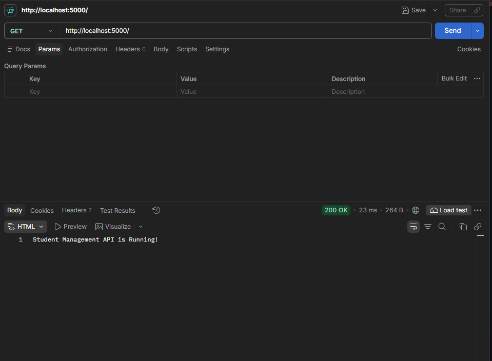
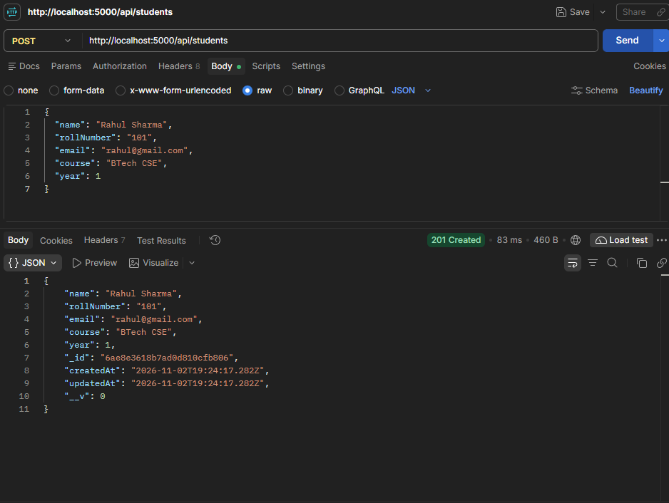
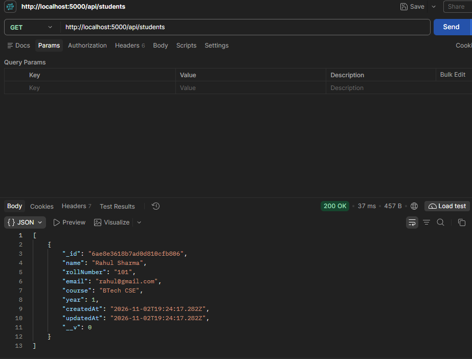
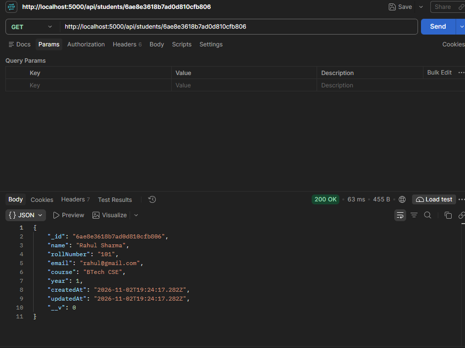
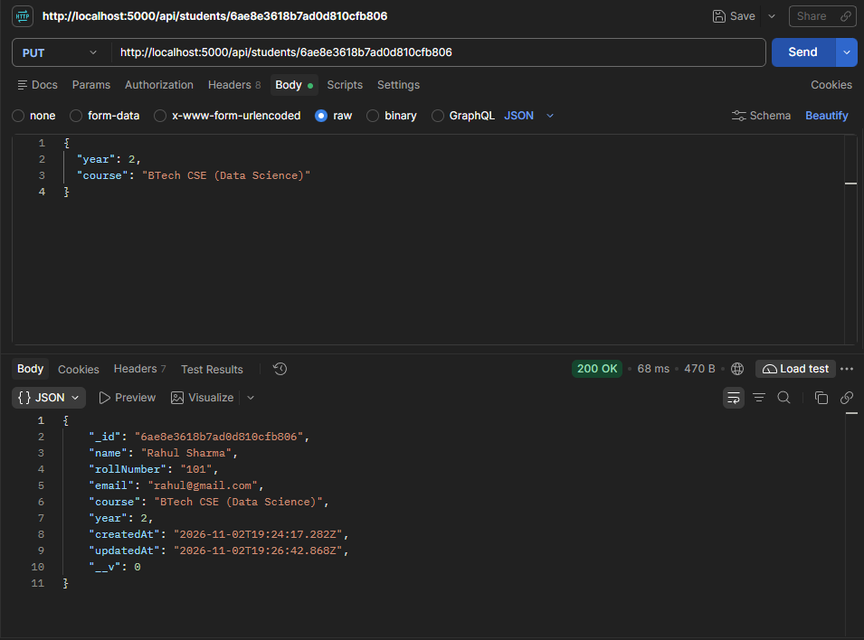

<div align="center">

  <h1>🎓 Student Management REST API</h1>
  <p><strong>A clean, modern, and beginner-friendly backend RESTful API for managing student records.</strong></p>

  <p>
    <a href="https://nodejs.org/"></a>
    <a href="https://expressjs.com/"></a>
    <a href="https://www.mongodb.com/atlas"></a>
    <a href="https://mongoosejs.com/"></a>
    <a href="https://developer.mozilla.org/en-US/docs/Web/JavaScript"></a>
    <a href="https://www.postman.com/"></a>
  </p>

  <p>
    <a href="https://skillicons.dev">
      
    </a>
  </p>

</div>

---

## 📌 Project Overview

The **Student Management API** is a RESTful web service built with **Node.js**, **Express.js**, and **MongoDB Atlas** using **Mongoose ODM**. It was created as a first-year BTech Computer Science & Engineering college project to demonstrate backend architectural design, database modeling, and complete CRUD (Create, Read, Update, Delete) capabilities.

The project follows a clean **MVC (Model-View-Controller)** pattern, uses standard modern **JavaScript ES Modules** (`import`/`export`), and adheres strictly to REST conventions with appropriate HTTP status codes and JSON formatting.

---

## ✨ Key Features

- ⚡ **Full CRUD Functionality**: Seamlessly register, retrieve, update, and remove student profiles.
- 🔒 **Safe ID Validation**: Checks 24-character hexadecimal MongoDB ObjectIds before querying, preventing server crashes on malformed requests.
- 🛡️ **Duplicate Prevention**: Enforces database-level unique constraints on both `rollNumber` and `email`.
- 🏷️ **Data Integrity**: Enforces strict Mongoose schema types for `name`, `rollNumber`, `email`, `course`, and `year`.
- ⏱️ **Automatic Timestamps**: Auto-generates `createdAt` and `updatedAt` timestamps for every record.
- 🌐 **Cloud Persistence**: Stores all persistent data securely in MongoDB Atlas.
- 🔐 **Isolated Configuration**: Protects secrets through `.env` environment variables excluded from version control.

---

## 🛠️ Technologies Used

| Technology | Purpose | Documentation |
| :--- | :--- | :--- |
| **Node.js** | Asynchronous JavaScript runtime engine | [nodejs.org](https://nodejs.org/) |
| **Express.js** | Minimalist web application framework for routing and middleware | [expressjs.com](https://expressjs.com/) |
| **MongoDB Atlas** | Fully managed multi-cloud NoSQL document database | [mongodb.com/atlas](https://www.mongodb.com/atlas) |
| **Mongoose** | Object Data Modeling (ODM) library for schema validation and queries | [mongoosejs.com](https://mongoosejs.com/) |
| **JavaScript (ES Modules)** | Native `import`/`export` syntax configured via `"type": "module"` | [developer.mozilla.org](https://developer.mozilla.org/) |
| **dotenv** | Loads secret configuration variables from `.env` into `process.env` | [npmjs.com/package/dotenv](https://www.npmjs.com/package/dotenv) |
| **Nodemon** | Development tool that monitors code changes and automatically restarts the server | [nodemon.io](https://nodemon.io/) |
| **Postman** | API platform for testing HTTP requests, response headers, and payloads | [postman.com](https://www.postman.com/) |
| **Git & GitHub** | Source code version control and public repository hosting | [github.com](https://github.com/) |

---

## 📂 Project Folder Structure

The project strictly follows a clean and lightweight MVC structure:

```text
student-management-api/
│
├── config/
│   └── db.js                  # MongoDB Atlas connection logic
│
├── controllers/
│   └── studentController.js   # CRUD business logic functions
│
├── models/
│   └── studentModel.js        # Mongoose schema and Student model definition
│
├── routes/
│   └── studentRoutes.js       # Route mappings for /api/students
│
├── screenshots/               # Actual Postman test screenshots
│   ├── 01-health-check.png
│   ├── 02-create-student.png
│   ├── 03-get-all-students.png
│   ├── 04-get-student-by-id.png
│   └── 05-update-student.png
│
├── .env                       # Local secrets & credentials (never committed)
├── .env.example               # Template showing required environment variables
├── .gitignore                 # Excludes .env and node_modules from Git
├── app.js                     # Express application instance, middleware & root route
├── index.js                   # Server entry point; connects DB and starts server
├── package.json               # Project metadata, dependencies, and npm scripts
├── package-lock.json          # Deterministic dependency tree lockfile
└── README.md                  # Comprehensive project documentation
```

---

## ⚙️ Installation and Setup

### Prerequisites
Make sure you have the following installed on your machine:
- [Node.js](https://nodejs.org/) (Version 18.x or newer recommended)
- [Git](https://git-scm.com/)
- A free account on [MongoDB Atlas](https://www.mongodb.com/atlas)

### Step-by-Step Installation

1. **Clone the repository**:
   ```bash
   git clone https://github.com/akarshitmakkar-coder/student-management-api.git
   cd student-management-api
   ```

2. **Install project dependencies**:
   ```bash
   npm install
   ```

3. **Set up environment variables**:
   Create a `.env` file in the root directory by copying the provided example:
   ```bash
   # On Windows PowerShell
   Copy-Item .env.example .env

   # On macOS / Linux
   cp .env.example .env
   ```

---

## 🔐 Environment Variables

Open your newly created `.env` file and configure your port and MongoDB Atlas connection string:

```env
PORT=5000
MONGO_URI=mongodb+srv://<username>:<password>@cluster0.xxxxx.mongodb.net/studentDB?retryWrites=true&w=majority
```

> [!IMPORTANT]
> - Replace `<username>` and `<password>` with your database user credentials created in MongoDB Atlas (**Security** &rarr; **Database Access**).
> - **Do not** include the `< >` angle brackets around your credentials.
> - Ensure your IP address is whitelisted in MongoDB Atlas (**Security** &rarr; **Network Access** &rarr; **Allow Access from Anywhere `0.0.0.0/0`** for local testing).
> - Never push your `.env` file to GitHub. It is already included in `.gitignore`.

---

## 🚀 How to Run the Project

### Development Mode (with automatic restart on file save):
```bash
npm run dev
```

### Production / Normal Mode:
```bash
npm start
```

### Expected Server Console Output:
```text
MongoDB Connected Successfully!
Server running on port 5000
```

Verify the server is running by opening `http://localhost:5000/` in your web browser. You will see:
```text
Student Management API is Running!
```

---

## 📡 API Endpoints

**Base URL**: `http://localhost:5000`

| HTTP Method | Endpoint | Description | Success Status |
| :--- | :--- | :--- | :--- |
| **GET** | `/` | Health check route | `200 OK` |
| **POST** | `/api/students` | Create and register a new student | `201 Created` |
| **GET** | `/api/students` | Retrieve all student records | `200 OK` |
| **GET** | `/api/students/:id` | Retrieve a single student by MongoDB ID | `200 OK` |
| **PUT** | `/api/students/:id` | Update an existing student's details | `200 OK` |
| **DELETE** | `/api/students/:id` | Remove a student record from database | `200 OK` |

---

## 🧪 Postman API Demonstrations & Examples

Below are the actual test requests executed and verified in Postman.

### 1. Health Check
- **Method**: `GET`
- **URL**: `http://localhost:5000/`
- **Status**: `200 OK`
- **Response**:
  ```text
  Student Management API is Running!
  ```



---

### 2. Create a Student
- **Method**: `POST`
- **URL**: `http://localhost:5000/api/students`
- **Headers**: `Content-Type: application/json`
- **Status**: `201 Created`

**Request Body**:
```json
{
  "name": "Rahul Sharma",
  "rollNumber": "101",
  "email": "rahul@gmail.com",
  "course": "BTech CSE",
  "year": 1
}
```

**Response**:
```json
{
  "name": "Rahul Sharma",
  "rollNumber": "101",
  "email": "rahul@gmail.com",
  "course": "BTech CSE",
  "year": 1,
  "_id": "6ae8e3618b7ad0d810cfb806",
  "createdAt": "2026-11-02T19:24:17.282Z",
  "updatedAt": "2026-11-02T19:24:17.282Z",
  "__v": 0
}
```



> [!TIP]
> **Getting the ID**: Copy the generated `_id` (`6ae8e3618b7ad0d810cfb806`) from the response to retrieve, update, or delete this student record.

---

### 3. Get All Students
- **Method**: `GET`
- **URL**: `http://localhost:5000/api/students`
- **Status**: `200 OK`

**Response**:
```json
[
  {
    "_id": "6ae8e3618b7ad0d810cfb806",
    "name": "Rahul Sharma",
    "rollNumber": "101",
    "email": "rahul@gmail.com",
    "course": "BTech CSE",
    "year": 1,
    "createdAt": "2026-11-02T19:24:17.282Z",
    "updatedAt": "2026-11-02T19:24:17.282Z",
    "__v": 0
  }
]
```



---

### 4. Get Student by ID
- **Method**: `GET`
- **URL**: `http://localhost:5000/api/students/6ae8e3618b7ad0d810cfb806`
- **Status**: `200 OK`

**Response**:
```json
{
  "_id": "6ae8e3618b7ad0d810cfb806",
  "name": "Rahul Sharma",
  "rollNumber": "101",
  "email": "rahul@gmail.com",
  "course": "BTech CSE",
  "year": 1,
  "createdAt": "2026-11-02T19:24:17.282Z",
  "updatedAt": "2026-11-02T19:24:17.282Z",
  "__v": 0
}
```



---

### 5. Update Student Details
- **Method**: `PUT`
- **URL**: `http://localhost:5000/api/students/6ae8e3618b7ad0d810cfb806`
- **Headers**: `Content-Type: application/json`
- **Status**: `200 OK`

**Request Body**:
```json
{
  "year": 2,
  "course": "BTech CSE (Data Science)"
}
```

**Response**:
```json
{
  "_id": "6ae8e3618b7ad0d810cfb806",
  "name": "Rahul Sharma",
  "rollNumber": "101",
  "email": "rahul@gmail.com",
  "course": "BTech CSE (Data Science)",
  "year": 2,
  "createdAt": "2026-11-02T19:24:17.282Z",
  "updatedAt": "2026-11-02T19:26:42.868Z",
  "__v": 0
}
```



---

### 6. Delete a Student
- **Method**: `DELETE`
- **URL**: `http://localhost:5000/api/students/6ae8e3618b7ad0d810cfb806`
- **Status**: `200 OK`

**Response**:
```json
{
  "message": "Student deleted successfully."
}
```

---

## ⚠️ Error Handling

The API returns consistent and structured JSON error responses with standard HTTP status codes:

| HTTP Status Code | Scenario | Sample Response |
| :--- | :--- | :--- |
| **`400 Bad Request`** | Invalid MongoDB ObjectId format | `{"message": "Invalid student ID format."}` |
| **`400 Bad Request`** | Duplicate `rollNumber` or `email` | `{"message": "Duplicate value: A student with this rollNumber or email already exists."}` |
| **`400 Bad Request`** | Missing required schema field | `{"message": "Student validation failed: name: Path `name` is required."}` |
| **`404 Not Found`** | ID does not exist in database | `{"message": "Student not found."}` |
| **`500 Internal Server Error`** | Server-side or connection failure | `{"message": "Internal server error details."}` |

---

## 👨‍💻 Author & Credits

- **Developer**: **Akarshit Makkar**
- **GitHub Profile**: [@akarshitmakkar-coder](https://github.com/akarshitmakkar-coder)
- **Academic Program**: First-Year BTech Computer Science & Engineering (CSE)
- **Repository**: [student-management-api](https://github.com/akarshitmakkar-coder/student-management-api)
- **License**: [ISC License](https://opensource.org/licenses/ISC)

---

<div align="center">
  <sub>Built with ❤️ as a first-year BTech CSE assignment. Star ⭐ this repository if you found it helpful!</sub>
</div>
